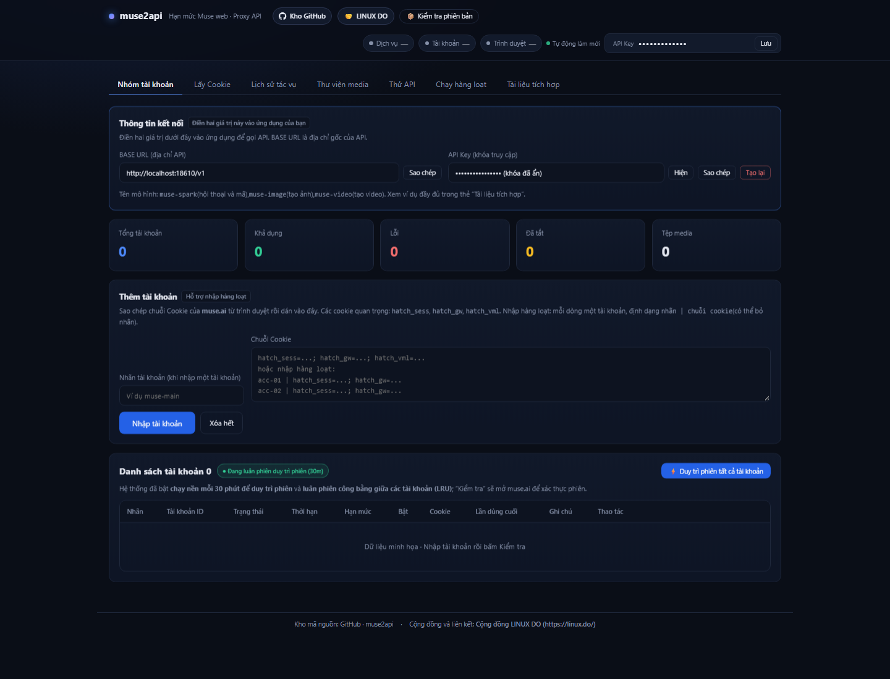
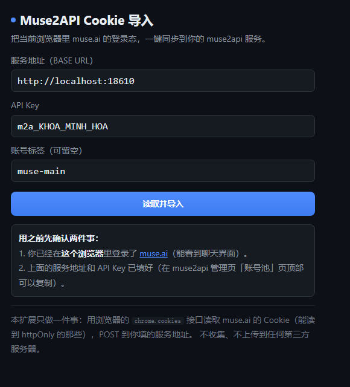
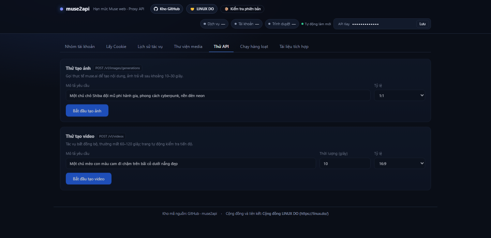
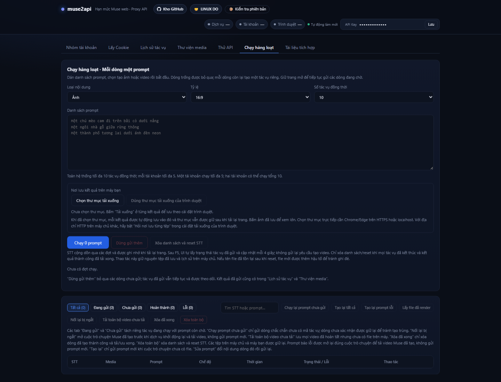

# Hướng dẫn sử dụng Muse2API

**Phiên bản đối chiếu: 1.6.1 · Ngày: 14/10/2026 · Dành cho Windows và giao diện tiếng Việt**

Muse2API là dịch vụ chạy trên máy bạn, dùng phiên đăng nhập Muse để cung cấp API hội thoại, tạo ảnh và tạo video. Bạn có thể thao tác trực tiếp trong trang quản trị hoặc kết nối ứng dụng tương thích OpenAI. Cần có tài khoản Muse dùng được và máy chạy dịch vụ phải truy cập được Muse.

## Mục lục

1. Chuẩn bị và khởi động
2. Cấu hình khóa trong .env
3. Đăng nhập trang quản trị
4. Nhập tài khoản bằng tiện ích
5. Nhập cookie thủ công
6. Kiểm tra tài khoản và hạn mức
7. Tạo ảnh và video đơn lẻ
8. Chạy hàng loạt
9. Khôi phục tác vụ và tải kết quả
10. Lịch sử tác vụ và thư viện media
11. Kết nối ứng dụng và gọi API
12. Cấu hình nâng cao
13. Docker và truy cập từ máy khác
14. Sao lưu, cập nhật và dừng dịch vụ
15. Khắc phục sự cố

Ảnh bên dưới được dựng từ HTML giao diện của dự án, với dữ liệu minh họa và mã JavaScript ứng dụng được tắt. Đây là ảnh hướng dẫn vị trí thao tác, không phải kết quả chạy tài khoản thật.

## 1. Chuẩn bị và khởi động

### 1.1. Điều kiện cần có

- Windows có Python 3.10 trở lên, Google Chrome hoặc Microsoft Edge.
- Có kết nối mạng để cài thư viện lần đầu và truy cập Muse khi sử dụng.
- Đủ dung lượng cho môi trường Python, profile trình duyệt và ảnh/video tạo ra. Ổ C vẫn cần dung lượng trống dù đặt dự án trên ổ F.
- Tài khoản đã đăng nhập được tại https://muse.ai/ và có quyền/hạn mức cho loại nội dung muốn tạo.

### 1.2. Chạy trên máy Windows hiện tại

1. Mở thư mục `F:\Tool\muse2api`.
2. Cấu hình khóa theo mục 2 trước khi sử dụng.
3. Bấm đúp `START.bat`.
4. Lần đầu, trình khởi động tạo `.venv` rồi cài các thư viện trong `requirements.txt`. Đợi quá trình hoàn tất.
5. Khi dịch vụ sẵn sàng, trang quản trị tự mở. Giữ cửa sổ terminal mở trong suốt thời gian chạy.

Có thể chạy từ PowerShell:

```powershell
Set-Location F:\Tool\muse2api
.\START.bat
```

Nếu trang không tự mở, vào `http://localhost:18610/admin`. Nếu đã đổi cổng, thay `18610` bằng cổng mới.

**Lưu ý:** Gói Windows này là mã nguồn có trình khởi động, chưa chứa sẵn Python. Không cần Docker hoặc WSL cho cách chạy này. Nếu `.env` đã tồn tại, trình khởi động giữ cấu hình hiện có; nó chỉ sinh khóa ngẫu nhiên khi chưa có file.

## 2. Cấu hình khóa trong .env

### 2.1. Giá trị đang được chọn trong IDE là gì?

`m2a_REPLACE_WITH_YOUR_SECURE_RANDOM_KEY` là giá trị mẫu. Hãy thay nó bằng khóa riêng của bạn tại dòng `MUSE2API_KEY=...`. Khóa này dùng cho cả trang quản trị, tiện ích nhập cookie và ứng dụng gọi API.

Trong terminal PowerShell, chạy lệnh sau để tạo một khóa ngẫu nhiên; lệnh chỉ in khóa, không tự sửa file:

```powershell
.\.venv\Scripts\python.exe -c "import secrets; print('m2a_' + secrets.token_urlsafe(32))"
```

Nếu chưa có `.venv`, dùng `py -3` thay cho `.\.venv\Scripts\python.exe`. Sao chép kết quả vào `.env`, lưu file rồi khởi động lại dịch vụ.

### 2.2. Mẫu cấu hình chạy cục bộ

```ini
MUSE2API_KEY=m2a_DAN_KHOA_NGAU_NHIEN_CUA_BAN_VAO_DAY
MUSE2API_HOST=127.0.0.1
MUSE2API_PORT=18610
MUSE2API_CHROMIUM=
MUSE2API_CONCURRENCY=2
MUSE2API_PER_ACCOUNT=1
MUSE2API_IMAGE_TIMEOUT=240
MUSE2API_VIDEO_TIMEOUT=600
MUSE2API_CHAT_TIMEOUT=300
```

Giá trị khóa trong ví dụ cũng là chỗ giữ chỗ. Với lần chạy đầu, 2 tác vụ toàn hệ thống và 1 tác vụ mỗi tài khoản giúp dễ theo dõi; tăng dần khi đã chạy ổn định. Hai giá trị này là cấu hình khởi đầu đề xuất, không phải mặc định của mã nguồn hiện tại.

Để trống `MUSE2API_CHROMIUM` cho phép tự dò trình duyệt. Nếu không tìm được Chrome/Edge, điền đường dẫn đầy đủ:

```ini
MUSE2API_CHROMIUM=C:\Program Files\Google\Chrome\Application\chrome.exe
```

**Sau mỗi lần sửa `.env`, dừng và chạy lại dịch vụ.** Biến môi trường đã được đặt trong hệ điều hành hoặc terminal có ưu tiên cao hơn giá trị cùng tên trong `.env`.

## 3. Đăng nhập trang quản trị



*Hình 1. Thanh chọn chức năng, thông tin kết nối và khu vực nhập tài khoản.*

1. Mở `http://localhost:18610/admin`.
2. Dán khóa của dòng `MUSE2API_KEY` vào ô API Key ở góc trên, nhấn **Lưu**. Khi chạy bằng `START.bat`, URL tự mở thường đã chứa khóa.
3. Vào **Nhóm tài khoản**. Trong **Thông tin kết nối**, sao chép BASE URL và API Key khi cần tích hợp.
4. Nút **Hiện** cho phép xem khóa; **Tạo lại** thay khóa và làm khóa cũ mất hiệu lực ngay. Sau khi tạo lại, cập nhật khóa trong tiện ích và mọi ứng dụng đang kết nối.

| Nơi sử dụng | Địa chỉ khi chạy cục bộ |
| --- | --- |
| Trang quản trị | http://localhost:18610/admin |
| Tiện ích nhập cookie | http://localhost:18610 |
| Ứng dụng tương thích OpenAI | http://localhost:18610/v1 |
| Kiểm tra dịch vụ | http://localhost:18610/healthz |

Trình duyệt lưu khóa để dùng lần sau. Không chia sẻ ảnh có khóa, cookie hoặc đường dẫn quản trị chứa `?key=...`.

## 4. Nhập tài khoản bằng tiện ích

Đây là cách thuận tiện nhất vì tiện ích đọc được cả cookie HttpOnly mà mã JavaScript thông thường trên trang không đọc được.

### 4.1. Cài tiện ích từ thư mục dự án

1. Chrome: mở `chrome://extensions`. Edge: mở `edge://extensions`.
2. Bật **Chế độ dành cho nhà phát triển / Developer mode**.
3. Chọn **Tải tiện ích đã giải nén / Load unpacked**.
4. Chọn đúng thư mục `F:\Tool\muse2api\extension`, nơi chứa `manifest.json`.
5. Ghim tiện ích trên thanh công cụ để dễ mở.

### 4.2. Đăng nhập và nhập phiên Muse



*Hình 2. Tiện ích có giao diện tiếng Trung; nhập địa chỉ dịch vụ, khóa và nhãn tài khoản.*

1. Trong chính trình duyệt vừa cài tiện ích, mở Muse và đăng nhập đến khi nhìn thấy giao diện sử dụng.
2. Mở tiện ích rồi nhập thông tin theo bảng bên dưới.
3. Bấm **读取并导入** để đọc cookie và nhập vào dịch vụ.
4. Khi tiện ích báo nhập thành công, quay lại **Nhóm tài khoản** và làm mới trang.
5. Bấm **Kiểm tra** cho tài khoản vừa nhập, sau đó xem trạng thái và hạn mức.

| Nhãn trên tiện ích | Ý nghĩa | Giá trị mẫu |
| --- | --- | --- |
| 服务地址（BASE URL） | Địa chỉ gốc dịch vụ | http://localhost:18610 |
| API Key | Khóa truy cập | Khóa trong .env |
| 账号标签（可留空） | Nhãn tài khoản, có thể bỏ trống | muse-main |
| 读取并导入 | Đọc và nhập cookie | Nút thực hiện |

Các cookie cốt lõi gồm `hatch_sess`, `hatch_gw`, `hatch_vml`, `hatch_native_auth_device`. Không dùng `document.cookie` để thay thế việc xuất cookie đầy đủ. Để thêm tài khoản khác, đăng nhập tài khoản đó trong trình duyệt rồi nhập tiếp với nhãn dễ phân biệt.

## 5. Nhập cookie thủ công

Nếu không dùng tiện ích, mở **Lấy Cookie** và làm theo phần **Sao chép thủ công**. Trong Developer Tools của trình duyệt, tìm một yêu cầu gửi đến Muse có header `Cookie`; sao chép giá trị header đầy đủ. Có thể cần tải lại trang để thấy yêu cầu mới.

1. Vào **Nhóm tài khoản → Thêm tài khoản**.
2. Nhập nhãn như `muse-main`.
3. Dán chuỗi cookie vào ô **Chuỗi Cookie**.
4. Bấm **Nhập tài khoản**, rồi **Kiểm tra**.

Nhập hàng loạt: mỗi dòng là một tài khoản, theo cấu trúc `nhãn | chuỗi cookie`:

```text
acc-01 | hatch_sess=GIA_TRI_1; hatch_gw=GIA_TRI_2; hatch_vml=GIA_TRI_3; hatch_native_auth_device=GIA_TRI_4
acc-02 | hatch_sess=GIA_TRI_5; hatch_gw=GIA_TRI_6; hatch_vml=GIA_TRI_7; hatch_native_auth_device=GIA_TRI_8
```

Đây là ví dụ cấu trúc, không phải cookie dùng được. Khi phiên thay đổi, dùng nút **Cập nhật Cookie** của đúng tài khoản để thay bằng chuỗi mới.

## 6. Kiểm tra tài khoản và hạn mức

| Mục / nút | Cách dùng và ý nghĩa |
| --- | --- |
| Kiểm tra | Xác thực phiên đăng nhập; đọc thông báo riêng về phiên và việc lấy hạn mức |
| Hạn mức | Truy vấn hạn mức của đúng tài khoản; chú ý thời điểm truy vấn và cảnh báo dữ liệu cũ |
| Duy trì phiên | Yêu cầu làm mới phiên/đánh thức môi trường Muse của tài khoản |
| Duy trì phiên tất cả tài khoản | Thực hiện cho cả nhóm theo cơ chế bảo trì |
| Bật / Tắt | Cho phép hoặc ngừng dùng tài khoản để xử lý tác vụ mới |
| Đổi tên | Đặt nhãn dễ nhận biết |
| Cập nhật Cookie | Nhập phiên mới cho tài khoản đang có |
| Xóa | Xóa tài khoản khỏi nhóm; kiểm tra kỹ trước khi xác nhận |

**Khả dụng** là kết quả đã xác nhận gần nhất, không bảo đảm mạng luôn thông suốt. **Chưa kiểm tra** nghĩa là chưa có xác nhận. **Lỗi** cần đọc ghi chú để biết nguyên nhân. **Đã tắt** không tham gia phân phối tác vụ mới.

Thời hạn cookie không chứng minh phiên vẫn được máy chủ Muse chấp nhận. Nếu đọc hạn mức thất bại, hệ thống có thể giữ số liệu cũ; đừng coi số liệu đó là số dư hiện tại. Di chuột lên ghi chú để xem lỗi đầy đủ.

Dịch vụ có vòng bảo trì nền mỗi 30 phút; việc gia hạn phụ thuộc phản hồi thực tế của Muse. Giữ dịch vụ chạy nếu muốn vòng bảo trì hoạt động. Tài khoản đã tắt không được tự bảo trì theo cấu hình mặc định.

## 7. Tạo ảnh và video đơn lẻ



*Hình 3. Hai biểu mẫu tạo nội dung trong thẻ Thử API.*

### 7.1. Tạo ảnh

1. Kiểm tra có ít nhất một tài khoản bật và dùng được.
2. Vào **Thử API → Thử tạo ảnh**.
3. Nhập mô tả chi tiết: chủ thể, bối cảnh, ánh sáng, phong cách, bố cục.
4. Chọn tỷ lệ: `1:1` cho ảnh vuông, `16:9` cho ảnh ngang, `9:16` cho ảnh dọc; giao diện còn có `4:3` và `3:4`.
5. Bấm **Bắt đầu tạo ảnh** một lần rồi đợi kết quả. Trang dùng tác vụ và tự kiểm tra trạng thái.
6. Xem ảnh trả về, tải ảnh hoặc vào **Thư viện media** để tìm lại.

Prompt mẫu: “Một căn nhà gỗ bên hồ vào bình minh, sương nhẹ, ánh sáng ấm, phong cách ảnh chụp, bố cục rộng 16:9.”

### 7.2. Tạo video

1. Trong cùng thẻ, tìm **Thử tạo video**.
2. Nhập chủ thể và hành động, chuyển động camera, bối cảnh và ánh sáng.
3. Chọn thời lượng yêu cầu và tỷ lệ. Các lựa chọn thời lượng trong chạy hàng loạt là 5, 6, 8 hoặc 10 giây.
4. Bấm **Bắt đầu tạo video**, đợi tiến độ và kết quả.
5. Xem trước rồi tải video về máy.

Prompt mẫu: “Một chú mèo cam đi chậm trên bãi cỏ, camera theo sát ngang tầm mắt, ánh sáng buổi sáng, chuyển động tự nhiên, khung hình 16:9.”

Thời lượng là yêu cầu gửi đến Muse; thời lượng thực tế phụ thuộc kết quả của Muse. Tiến độ là chỉ báo xử lý, không phải cam kết thời điểm hoàn tất. Độ trễ thay đổi theo hàng đợi, mạng và tài khoản; tránh bấm tạo nhiều lần khi yêu cầu đang chạy.

## 8. Chạy hàng loạt



*Hình 4. Thiết lập loại nội dung, tỷ lệ, mức đồng thời, prompt và nơi lưu.*

### 8.1. Chuẩn bị danh sách

1. Vào **Chạy hàng loạt**.
2. Chọn **Ảnh** hoặc **Video**. Chọn tỷ lệ và thời lượng nếu tạo video.
3. Đặt số tác vụ đồng thời. Với tài khoản mới hoặc máy yếu, bắt đầu bằng 1–2.
4. Dán prompt, **mỗi dòng một prompt**. Dòng trống được bỏ qua; prompt bị xuống dòng sẽ trở thành nhiều tác vụ riêng.
5. Chọn thư mục tải xuống trước khi chạy nếu muốn tự lưu kết quả.
6. Bấm **Chạy N prompt** và giữ trang mở để tiếp tục gửi những dòng đang chờ.

```text
Một căn nhà gỗ bên hồ lúc bình minh, ánh sáng ấm
Một khu rừng thông trong sương sớm, camera tiến chậm
Một con phố tương lai ban đêm, ánh đèn neon phản chiếu trên mặt đường
```

### 8.2. Chọn nơi lưu kết quả

**Chọn thư mục tải xuống** cho phép trình duyệt xin quyền ghi vào thư mục bạn chọn. Trên Chrome/Edge, tính năng chọn thư mục trực tiếp cần localhost hoặc HTTPS. Khi đã chọn và có quyền ghi, kết quả được tự lưu vào đó.

Nếu không chọn thư mục, dùng **Tải xuống** ở từng kết quả và cài đặt tải xuống của trình duyệt. Khi truy cập máy chủ khác bằng HTTP, có thể bật tùy chọn trình duyệt hỏi nơi lưu từng tệp. Sau F5, hãy kiểm tra trạng thái quyền thư mục và cấp lại nếu trình duyệt yêu cầu.

### 8.3. Giới hạn đồng thời

Số thực thi phụ thuộc đồng thời vào lựa chọn giao diện, giới hạn toàn dịch vụ `MUSE2API_CONCURRENCY`, giới hạn mỗi tài khoản `MUSE2API_PER_ACCOUNT` và số tài khoản dùng được. Ví dụ: đặt toàn dịch vụ là 4, mỗi tài khoản là 2, có một tài khoản thì tối đa 2 tác vụ sử dụng tài khoản đó cùng lúc; hai tài khoản có thể đạt 4 nếu đều sẵn sàng.

Ảnh bất đồng bộ còn có giới hạn riêng: tối đa 8 tác vụ ảnh chưa kết thúc trong một tiến trình. Khi nhận 429 do đầy hàng đợi, chờ bớt tác vụ kết thúc rồi thử lại. Tăng số tác vụ không bảo đảm tăng tốc và có thể làm máy thiếu bộ nhớ hoặc gặp hạn chế phía Muse.

### 8.4. Dừng và tải lại trang

**Dừng gửi thêm** dừng gửi các dòng còn lại; những tác vụ đã gửi vẫn chạy. Giữ máy chủ hoạt động để chúng hoàn tất. Sau F5, giao diện khôi phục danh sách đã lưu trong trình duyệt, lấy trạng thái tác vụ đã gửi và cập nhật khoảng mỗi 4 giây. Khôi phục danh sách không có nghĩa là gửi lại prompt.

STT cộng dồn qua nhiều đợt. Dùng cùng trình duyệt và cùng địa chỉ trang để tiếp tục danh sách cũ; chuyển trình duyệt, đổi địa chỉ hoặc xóa dữ liệu trình duyệt có thể khiến danh sách cục bộ không còn xuất hiện.

## 9. Khôi phục tác vụ và tải kết quả

| Nút | Khi nên sử dụng |
| --- | --- |
| Chạy lại prompt chưa gửi | Gửi các dòng chắc chắn chưa có mã tác vụ |
| Lấy file đã render | Thử thu hồi kết quả đã tạo trên Muse cho dòng lỗi |
| Nối lại bị ngắt | Mở lại cuộc trò chuyện cũ để lấy video sau khi dịch vụ bị gián đoạn |
| Tải toàn bộ video chưa tải | Lưu video hoàn tất nhưng chưa tải/lưu trên máy bạn |
| Tạo lại prompt lỗi | Thử lại nhóm lỗi; việc tạo mới có thể tiêu hao thêm hạn mức |
| Tạo lại tất cả | Thử lại cả danh sách theo cơ chế xử lý của giao diện |
| Sửa prompt | Sửa nội dung rồi gửi lại; xem là yêu cầu mới |
| Xóa đã xong | Dọn dòng thành công đã tải/lưu xong |
| Xóa toàn bộ | Xóa danh sách và reset STT khi đủ điều kiện; tệp đã lưu vẫn được giữ |

Khi tác vụ báo lỗi nhưng có khả năng Muse đã tạo xong, thử **Lấy file đã render** hoặc **Nối lại bị ngắt** trước. Việc thu hồi phụ thuộc cuộc trò chuyện và phiên tài khoản còn truy cập được. Đừng gửi lại ngay chỉ vì mất kết nối: yêu cầu cũ có thể vẫn đang chạy.

Nếu hiện trạng thái gửi chưa được xác nhận, giữ dòng đó để đối chiếu **Lịch sử tác vụ**. Chỉ chạy prompt chưa gửi khi chắc chắn chưa có tác vụ. Khi reset STT và tên tệp bị trùng, cơ chế lưu của giao diện thêm hậu tố để tránh ghi đè.

## 10. Lịch sử tác vụ và thư viện media

**Lịch sử tác vụ** hiển thị ID, loại nội dung, prompt, trạng thái, thời gian và kết quả/lỗi. Dùng **Làm mới** khi cần kiểm tra lại. Ghi lại ID nếu cần tra cứu hoặc báo lỗi.

| Trạng thái API | Ý nghĩa |
| --- | --- |
| queued | Đã nhận và chờ xử lý |
| processing | Đang thực hiện |
| completed | Đã hoàn tất, đọc URL kết quả |
| failed | Có lỗi, đọc trường error |

API video hiện tại trả trạng thái hoàn tất là `completed`; không chỉ chờ `succeeded` như một số ví dụ README cũ.

**Thư viện media** chứa ảnh/video đã lưu trên máy chủ, trong `data/media`. Tệp trên máy chủ và tệp tải về máy khách là hai bản riêng. Có thể xem trước, tải về và dùng liên kết kết quả. Chỉ chọn **Xóa mục đã chọn** khi thật sự muốn xóa tệp media trên máy chủ; đường dẫn tới tệp bị xóa sẽ không còn dùng được.

Xóa dòng ở danh sách chạy hàng loạt khác với xóa media. Việc dọn danh sách không tự xóa tệp đã tải. Hãy lưu kết quả quan trọng trước khi dọn lịch sử hoặc tệp trên máy chủ.

## 11. Kết nối ứng dụng và gọi API

### 11.1. Ba giá trị cần điền

| Trường | Giá trị |
| --- | --- |
| Base URL | http://localhost:18610/v1 |
| API Key | Khóa thật đang có hiệu lực của dịch vụ |
| Model hội thoại | muse-spark |
| Model ảnh | muse-image |
| Model video | muse-video |

`localhost` luôn là máy đang chạy ứng dụng gọi API. Nếu ứng dụng ở máy khác, dùng IP/tên miền của máy chủ thay cho localhost. Nếu ứng dụng tự thêm `/v1`, làm theo cách cấu hình của ứng dụng để tránh `/v1/v1`.

Tương thích giao thức không có nghĩa là có mọi chức năng của OpenAI. Cơ chế công cụ/function calling mặc định tắt; không nên dựa vào dịch vụ này cho luồng bắt buộc gọi công cụ.

### 11.2. Gọi hội thoại bằng PowerShell

Các ví dụ sau dùng cùng cửa sổ PowerShell. Nhập khóa bằng `Read-Host` để không ghi khóa trực tiếp trong lệnh mẫu:

```powershell
$base = 'http://localhost:18610'
$apiKey = Read-Host 'Nhap MUSE2API_KEY'
$headers = @{ Authorization = "Bearer $apiKey" }

Invoke-RestMethod -Uri "$base/v1/models" -Headers $headers

$body = @{
    model = 'muse-spark'
    messages = @(
        @{ role = 'system'; content = 'Tra loi bang tieng Viet.' }
        @{ role = 'user'; content = 'Giai thich ngan gon API la gi.' }
    )
    stream = $false
} | ConvertTo-Json -Depth 10

$chat = Invoke-RestMethod -Method Post -Uri "$base/v1/chat/completions" `
    -Headers $headers -ContentType 'application/json; charset=utf-8' `
    -Body ([System.Text.Encoding]::UTF8.GetBytes($body)) -TimeoutSec 360
$chat.choices[0].message.content
```

### 11.3. Tạo ảnh bằng tác vụ bất đồng bộ

Nên dùng tạo tác vụ rồi kiểm tra trạng thái, đặc biệt khi đi qua reverse proxy/CDN. Khóa idempotency giúp cùng một nội dung và cùng khóa trả về tác vụ cũ thay vì tạo ảnh trùng.

```powershell
$imageBody = @{
    model = 'muse-image'
    prompt = 'A wooden house beside a lake at sunrise, warm light'
    size = '16:9'
    response_format = 'url'
} | ConvertTo-Json
$imageHeaders = @{
    Authorization = "Bearer $apiKey"
    'Idempotency-Key' = [guid]::NewGuid().ToString()
}
$task = Invoke-RestMethod -Method Post -Uri "$base/v1/images/tasks" `
    -Headers $imageHeaders -ContentType 'application/json' -Body $imageBody
$task.id

# Chay lai lenh GET nay moi 3-4 giay; dung khi completed hoac failed.
$state = Invoke-RestMethod -Uri "$base/v1/images/tasks/$($task.id)" -Headers $headers
$state | ConvertTo-Json -Depth 10

# Chi tai sau khi status la completed.
if ($state.status -eq 'completed') {
    $url = $state.url
    if (-not $url) { $url = $state.data[0].url }
    Invoke-WebRequest -Uri $url -OutFile '.\ket-qua-anh.webp'
}
```

Nếu POST bị ngắt và chưa nhận được ID, thử lại **cùng** `$imageHeaders` và **cùng** nội dung. Không sinh khóa idempotency mới cho lần thử lại đó. Cùng khóa nhưng nội dung khác trả 409. Khi GET lỗi, thử lại GET; không POST lại tác vụ đã có ID.

### 11.4. Tạo video và kiểm tra trạng thái

```powershell
$videoBody = @{
    model = 'muse-video'
    prompt = 'An orange kitten walking on grass, smooth tracking camera'
    duration = 6
    size = '16:9'
} | ConvertTo-Json
$videoTask = Invoke-RestMethod -Method Post -Uri "$base/v1/videos" `
    -Headers $headers -ContentType 'application/json' -Body $videoBody
$videoTask.id

# Kiem tra lai moi 3-4 giay cho den trang thai cuoi.
$videoState = Invoke-RestMethod -Uri "$base/v1/videos/$($videoTask.id)" -Headers $headers
$videoState | ConvertTo-Json -Depth 10
if ($videoState.status -eq 'completed') {
    Invoke-WebRequest -Uri $videoState.url -OutFile '.\ket-qua-video.mp4'
}
```

### 11.5. Dùng ảnh tham chiếu

Trong JSON tạo tác vụ ảnh hoặc tạo video, thêm `reference_image` là URL HTTP(S) mà máy chủ đọc được, hoặc Data URL của ảnh. Để dùng ảnh trên máy Windows:

```powershell
$imageBytes = [System.IO.File]::ReadAllBytes('F:\Anh\tham-chieu.png')
$reference = 'data:image/png;base64,' + [Convert]::ToBase64String($imageBytes)
# Them reference_image = $reference vao hashtable truoc ConvertTo-Json.
```

Với JPEG, dùng MIME `image/jpeg`. Gửi đường dẫn `F:\Anh\...` trực tiếp trong `reference_image` không thay thế việc tải ảnh lên. Prompt nên mô tả phần cần giữ và phần cần thay đổi. Video dùng ảnh tham chiếu như yêu cầu ảnh đầu vào/khung hình đầu, nhưng kết quả vẫn phụ thuộc Muse.

### 11.6. Các endpoint chính

| Phương thức và đường dẫn | Công dụng |
| --- | --- |
| GET /v1/models | Danh sách model |
| POST /v1/chat/completions | Hội thoại, hỗ trợ stream |
| POST /v1/responses | Giao thức Responses |
| POST /v1/images/tasks | Tạo tác vụ ảnh, trả HTTP 202 |
| GET /v1/images/tasks/{id} | Kiểm tra tác vụ ảnh |
| POST /v1/images/generations | Tạo ảnh đồng bộ; có thể gửi async=true |
| POST /v1/images/edits | Chỉnh ảnh, JSON hoặc multipart; có thể gửi async=true |
| POST /v1/videos | Tạo tác vụ video |
| GET /v1/videos/{id} | Kiểm tra tác vụ video |
| GET /v1/media/{filename} | Lấy tệp kết quả |

Các endpoint nghiệp vụ cần `Authorization: Bearer <khóa>`. `/healthz`, `/readyz` và `/v1/media/*` không cần khóa; người có URL media có thể truy cập tệp khi dịch vụ được công khai.

## 12. Cấu hình nâng cao

| Biến | Tác dụng / giá trị trong mã nguồn hiện tại |
| --- | --- |
| MUSE2API_KEY | Khóa quản trị và API; phải thay giá trị mẫu |
| MUSE2API_HOST | Mã nguồn mặc định 0.0.0.0; cấu hình Windows mới do launcher tạo dùng 127.0.0.1 |
| MUSE2API_PORT | Cổng HTTP, mặc định 18610 |
| MUSE2API_CHROMIUM | Đường dẫn Chrome/Edge/Chromium; để trống để tự dò |
| MUSE2API_CDP_PORT | Cổng điều khiển trình duyệt nội bộ, mặc định 19210 |
| MUSE2API_CONCURRENCY | Giới hạn toàn hệ thống; mã nguồn và Compose mặc định 8; launcher tạo .env mới đặt 10 |
| MUSE2API_PER_ACCOUNT | Giới hạn mỗi tài khoản; mã nguồn và Compose mặc định 30; launcher tạo .env mới đặt 5 |
| MUSE2API_IMAGE_TIMEOUT | Ngân sách chờ tạo ảnh mặc định 240 giây |
| MUSE2API_VIDEO_TIMEOUT | Thời gian chờ video mặc định 600 giây |
| MUSE2API_CHAT_TIMEOUT | Thời gian chờ hội thoại mặc định 300 giây |
| MUSE2API_PUBLIC_BASE | Địa chỉ công khai gốc, ví dụ https://muse.example.com |
| MUSE2API_PROFILE_ROOT | Nơi lưu profile trình duyệt; launcher ưu tiên browser-profiles cạnh dự án nếu chưa cấu hình |
| MUSE2API_KEEPALIVE_DISABLED_ACCOUNTS | 0 mặc định; 1 cho phép bảo trì tài khoản đã tắt |
| MUSE2API_SESSION_VIEW_TTL | Thời gian giữ phiên xem tác vụ, mặc định 120 giây |
| MUSE2API_SESSION_VIEW_MAX_RETAINED | Số phiên xem được giữ, mặc định 2 |

Giá trị thực tế là cấu hình có hiệu lực lúc chạy; README và Windows quickstart cũ có thể mô tả mặc định khác. Với ảnh bất đồng bộ, trường `timeout` nhận từ 1 đến 600 giây cho ngân sách chờ; khởi tạo trình duyệt và lấy kết quả còn có thời gian chờ riêng.

## 13. Docker và truy cập từ máy khác

### 13.1. Docker Compose

Tại thư mục dự án, cấu hình khóa trong `.env` rồi chạy:

```powershell
docker compose up -d --build
docker compose logs -f muse2api
```

Mở `http://localhost:18610/admin`, nhập khóa và nhập tài khoản như các mục trên. Compose hiện tại gắn `./data` vào `/app/data`. Không chạy bản Windows và Docker trên cùng cổng 18610 cùng lúc.

File Compose hiện tại đặt `MUSE2API_PUBLIC_BASE` là chuỗi rỗng và đặt trực tiếp các timeout. Muốn đổi các giá trị đó trong container, chỉnh mục `environment` của `docker-compose.yml`; chỉ sửa `.env` chưa đủ nếu Compose không tham chiếu biến đó. Sau sửa, chạy lại `docker compose up -d --build`.

### 13.2. Cho máy khác trong LAN truy cập

1. Đặt `MUSE2API_HOST=0.0.0.0`, lưu `.env` và khởi động lại bản Windows.
2. Lấy IP LAN của máy chủ bằng `ipconfig`, ví dụ `192.168.1.50`.
3. Cho phép cổng dịch vụ trong Windows Firewall trên mạng bạn cần dùng.
4. Máy khác mở `http://192.168.1.50:18610/admin`.
5. Ứng dụng dùng `http://192.168.1.50:18610/v1`; tiện ích dùng địa chỉ gốc không có `/v1`.

Không điền `0.0.0.0` làm địa chỉ kết nối của máy khách. Không mở cổng CDP 19210 ra Internet. Nếu công khai dịch vụ, dùng khóa riêng và HTTPS; đặt `MUSE2API_PUBLIC_BASE` thành tên miền gốc để URL kết quả dùng được từ máy khách.

### 13.3. Khi có Nginx/reverse proxy

Cấu hình mẫu nằm ở `deploy/nginx.example.conf`. Các điểm chính cho tạo nội dung lâu và hội thoại streaming:

```nginx
proxy_read_timeout 600s;
proxy_send_timeout 600s;
proxy_buffering off;
client_max_body_size 64M;
```

Đây là các chỉ thị bên trong cấu hình location phù hợp, không phải toàn bộ file Nginx. Nếu CDN có giới hạn chờ riêng, dùng API ảnh bất đồng bộ để POST ngắn và kiểm tra trạng thái.

## 14. Sao lưu, cập nhật và dừng dịch vụ

### 14.1. Dừng / chạy lại

Với Windows, nhấn `Ctrl+C` trong terminal để dừng, rồi chạy lại `START.bat`. Chờ tác vụ đang chạy kết thúc và tải kết quả quan trọng trước khi dừng chủ động. Tác vụ ảnh chưa hoàn tất khi tiến trình khởi động lại bị đánh dấu thất bại; nó không tự tạo lại ảnh.

Với Docker, dùng `docker compose stop` để dừng và `docker compose up -d` để chạy lại.

### 14.2. Sao lưu

Dừng dịch vụ rồi sao chép `.env`, `data/` và thư mục profile thực tế (thường là `browser-profiles/` khi chạy qua launcher) vào nơi riêng. `data/` chứa tài khoản, lịch sử và media; bảo vệ bản sao lưu như dữ liệu đăng nhập. Không cần sao lưu `.venv` hoặc `.pip-cache` nếu chỉ muốn giữ cấu hình và kết quả.

### 14.3. Cập nhật

Trang quản trị có thể hiển thị thông báo phiên bản mới và nút cập nhật. Chỉ cập nhật khi đã sao lưu và không còn tác vụ quan trọng đang chạy. Máy đang có thay đổi mã nguồn riêng cần giữ lại thay đổi trước khi lấy bản mới; không thay toàn bộ thư mục bằng gói mới rồi làm mất dữ liệu.

Với bản Git sạch, có thể dùng `git pull --ff-only` rồi khởi động lại. Với Docker, sau khi lấy mã mới chạy `docker compose up -d --build`. Với gói Windows giải nén, giữ `.env`, `data/` và profile khi thay mã nguồn. Sau cập nhật, mở lại trang, xác nhận cấu hình và kiểm tra một tài khoản.

## 15. Khắc phục sự cố

| Hiện tượng | Kiểm tra / cách xử lý |
| --- | --- |
| START.bat báo thiếu Python | Kiểm tra Python 3.10+; thử py -3 --version; cài Python nếu chưa có |
| Không tìm thấy trình duyệt | Cài Chrome/Edge hoặc đặt đúng MUSE2API_CHROMIUM; kiểm tra file thực sự tồn tại |
| Port 18610 is already in use | Dừng phiên dịch vụ cũ; hoặc đổi MUSE2API_PORT rồi cập nhật địa chỉ trong tiện ích/ứng dụng |
| Không mở được /admin | Kiểm tra terminal còn chạy, đúng cổng, đúng IP; máy khác cần host 0.0.0.0 và quyền firewall |
| API trả 401 | Đối chiếu khóa dịch vụ; lưu khóa mới trong trang và cập nhật tiện ích/ứng dụng; khóa mẫu không phải khóa riêng |
| Tiện ích không có cookie | Đăng nhập Muse trong đúng trình duyệt; dùng tiện ích để đọc HttpOnly; kiểm tra đúng tài khoản |
| Tiện ích Failed to fetch | Kiểm tra dịch vụ đang chạy, địa chỉ, HTTPS/chứng chỉ và quyền tiện ích; thử mở địa chỉ quản trị trực tiếp |
| Không có tài khoản khả dụng | Nhập tài khoản, bật tài khoản và bấm Kiểm tra; xem cookie, hạn mức và ghi chú |
| Muse /api/session trả 401 | Phiên bị Muse từ chối; đăng nhập lại trên Muse rồi nhập cookie mới |
| Muse trả 403 | Xem quyền tài khoản, mạng/địa chỉ ra Internet của máy chủ và giới hạn truy cập; không kết luận ngay là cookie hết hạn |
| Muse trả 429 | Chờ, giảm mức đồng thời; phân biệt hạn chế Muse với hàng đợi ảnh của dịch vụ đã đầy |
| Hạn mức đứng yên hoặc có dữ liệu cũ | Xem thời điểm truy vấn; bấm Hạn mức và đọc lỗi; dữ liệu cache không phải số dư mới |
| Ảnh/video chậm hoặc timeout | Giảm đồng thời, kiểm tra mạng, xem ID và lỗi tác vụ; kiểm tra kết quả đã render trước khi tạo lại |
| 502/504 sau reverse proxy | Kiểm tra timeout proxy; với ảnh chuyển sang POST tác vụ + GET trạng thái |
| Không chọn được thư mục lưu | Dùng Chrome/Edge trên localhost/HTTPS; cấp quyền ghi hoặc tải theo cơ chế trình duyệt |
| F5 mất danh sách batch | Kiểm tra cùng trình duyệt và cùng địa chỉ; tìm tác vụ đã gửi trong Lịch sử tác vụ thay vì tạo lại ngay |
| Link media không mở ở máy khác | Link localhost trỏ về máy khách; cấu hình PUBLIC_BASE đúng IP/tên miền và kiểm tra tệp còn tồn tại |
| Streaming chỉ hiện khi kết thúc | Tắt proxy_buffering và kiểm tra ứng dụng có xử lý SSE |

Khi cần báo lỗi, ghi lại phiên bản, Windows/Docker, thời gian, ID tác vụ, HTTP status, thao tác đã làm và thông báo đầy đủ. Che khóa, cookie và URL có `key` trước khi gửi ảnh hoặc log.

### Kiểm tra hoàn thành lần cài đầu

- Dịch vụ khởi động được và `/admin` mở bình thường.
- Đã thay khóa mẫu bằng khóa riêng.
- Ít nhất một tài khoản đã bật và kiểm tra thành công.
- Đã tạo thử một ảnh hoặc video và tải kết quả về máy.
- Nếu dùng batch, đã thử một danh sách ngắn và xác nhận nơi lưu.
- Nếu tích hợp ứng dụng, đã kiểm tra BASE URL, API Key và model.

### Tệp tham chiếu trong dự án

Nội dung đối chiếu từ `config.py`, `launch.py`, `START.bat`, `app.py`, `admin.html`, `extension/popup.html`, `extension/popup.js`, `docker-compose.yml` và `version.json` của bản mã hiện có.
